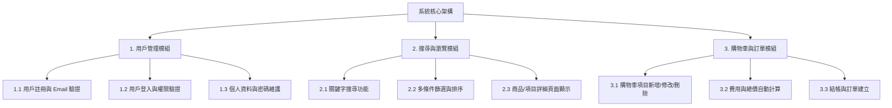
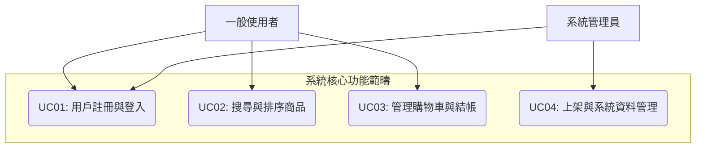

# 小組作業 3：系統需求與架構分析 (hw3.md)

## 1. 功能性需求與非功能性需求

### 功能性需求 (Functional Requirements)
1. **用戶註冊與登入**
   - 系統必須允許新用戶建立帳號，提供用戶名、密碼及 Email 進行註冊，並發送驗證郵件驗證有效性。
   - 系統應提供身份驗證與權限管理機制，支援登入、登出及密碼重置功能。
2. **商品/項目搜尋與排序**
   - 系統必須提供關鍵字搜尋功能，允許用戶即時搜尋目標商品或資料項目。
   - 搜尋結果應包含完整資訊（如名稱、價格、縮略圖及詳細規格），並支援按價格、上架時間或評分進行多條件排序與篩選。
3. **購物車與訂單處理**
   - 系統必須允許用戶將商品新增至購物車、檢視購物車內容、修改數量或刪除項目。
   - 系統應能自動計算購物車內商品的總價與折扣，並導向結帳與訂單建立流程。

---

### 非功能性需求 (Non-functional Requirements)
1. **性能 (Performance)**
   - 系統網頁應於 3 秒內完成載入，搜尋功能須於 1 秒內回傳查詢結果。
   - 系統架構須能同時承受至少 1000 名並發用戶的線上操作。
2. **安全性 (Security)**
   - 所有用戶密碼必須使用高安全性演算法（如 SHA-256 / bcrypt）進行加鹽加密儲存。
   - 系統必須全面採用 HTTPS 協定傳輸資料，並具備防範 SQL 注入（SQL Injection）與跨站腳本攻擊（XSS）之防護機制。
3. **可用性與相容性 (Availability & Compatibility)**
   - 系統應保持至少 99.9% 的正常運行時間（Uptime）。
   - 系統界面須相容於主流瀏覽器（包含 Chrome、Firefox、Safari、Edge 之最新版本），並符合 Web 內容無障礙指南 (WCAG) 2.1 AA 級標準。

---

## 2. 功能分解圖 (Functional Decomposition Diagram, FDD)

