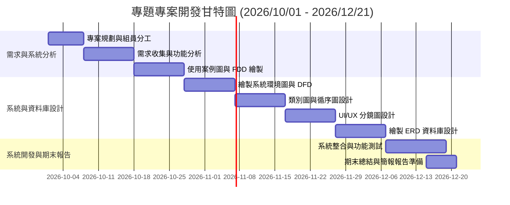
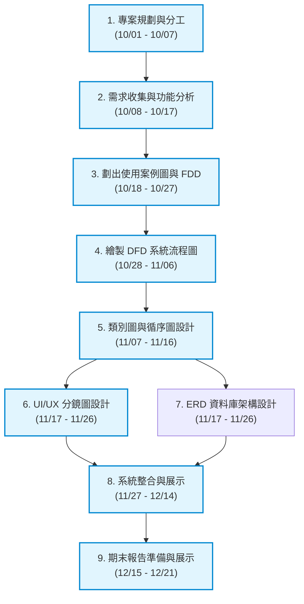

# 小組作業 2：專題專案規劃與時程管理

## 1. 專案基本資訊
* **專題名稱**：線上德州撲克多人對戰與策略分析平台
* **專案時程**：2026/10/01 – 2026/12/21
* **繳交日期**：2026/10/09

---

## 2. 個別組員任務分配表

| 組員姓名 | 專案角色 / 職責 | 主要負責任務項目 |
| :--- | :--- | :--- |
| **藍士驊** | 專案管理與系統分析 | 專案進度管控、需求分析與收集、彙整專案報告 |
| **莊又任** | 系統分析與需求設計 | 繪製功能分解圖 (FDD) 與使用案例圖 (Use Case Diagram) |
| **龔宇謙** | 系統流程與介面設計 | 繪製系統環境圖與 DFD (Data Flow Diagram)、UI/UX 分鏡圖 (Storyboard) |
| **謝皓翔** | 物件導向與資料庫設計 | 繪製類別圖 (Class Diagram)、循序圖與實體關係圖 (ERD) |
| **王惟平** | 系統測試與簡報製作 | 系統功能測試與除錯、專題期初與期末報告簡報/影片製作 |

---

## 3. 專題甘特圖 (Gantt Chart)

