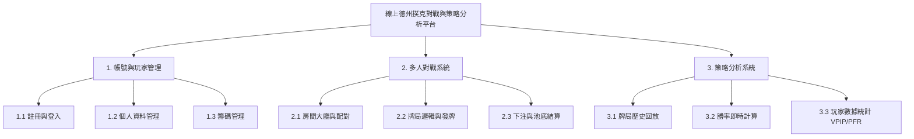

# 小組作業 3：需求分析與系統架構設計

* **專題名稱**：線上德州撲克多人對戰與策略分析平台
* **繳交日期**：2026/10/19

---

## 1. 系統需求分析

### (1) 功能性需求 (Functional Requirements)
1. **玩家對戰與房間管理**：系統須支援玩家建立房間、加入對戰、盲注設定與實時撲克發牌與下注流程。
2. **手牌歷史與數據記錄**：系統須自動記錄每場對局的過程（包括手牌、下注動作、池底大小），並提供玩家隨時查閱歷史牌局。
3. **策略分析與勝率計算**：系統須提供 EV (Expected Value) 勝率計算與 VPIP/PFR 等玩家風格數據分析，協助玩家檢討對局策略。

### (2) 非功能性需求 (Non-Functional Requirements)
1. **效能與實時性**：發牌與玩家下注動作的網路延遲 (Latency) 需低於 500 毫秒，以確保即時連線對戰順暢。
2. **安全性與公正性**：洗牌演算法須具備密碼學等級的隨機性 (RNG)，且玩家通訊須加密，防止看牌外掛與資料竄改。
3. **可用性與擴充性**：系統服務可用性 (Availability) 須達到 99.5% 以上，並能在熱門時段支援至少 1000 名玩家同時線上對戰。

---

## 2. 功能分解圖


## 3. 使用案例圖 
```mermaid
flowchart LR
    subgraph 系統邊界：線上德州撲克平台
        UC1((UC1: 進行牌局對戰))
        UC2((UC2: 查看對局歷史記錄))
        UC3((UC3: 查看策略分析報告))
        UC4((UC4: 管理房間與盲注))
        UC5((UC5: 系統洗牌與牌局結算))
    end

    Player[玩家] --> UC1
    Player --> UC2
    Player --> UC3
    
    System((平台系統)) --> UC5
    System --> UC4
```

## 4. 使用案例說明
使用案例 1：進行牌局對戰 (UC1)
主要參與者：玩家 (Player)

簡要說明：玩家進入牌局房間後，進行即時下注、蓋牌、跟注或加註，並完成整場牌局。

前置條件：玩家已成功登入系統且擁有足夠的遊戲籌碼。

基本流程：

玩家選擇進入相應盲注級別的房間。

系統自動進行洗牌與發牌（盲注與底牌）。

玩家進行各輪下注動作（翻牌前、翻牌、轉牌、河牌）。

牌局結束進行比牌，系統自動將池底籌碼分配給獲勝玩家。

後置條件：更新玩家籌碼餘額，並將對局紀錄寫入資料庫。

使用案例 2：查看對局歷史記錄 (UC2)
主要參與者：玩家 (Player)

簡要說明：玩家進入對局紀錄頁面，查詢並回放過往參與過的牌局過程。

前置條件：玩家已登入系統，且曾完成至少一場對局。

基本流程：

玩家點選「歷史牌局」頁面。

系統列出該玩家近期參與的牌局清單（包含時間、盈虧籌碼、手牌類別）。

玩家點擊特定牌局，系統載入並重現該對局逐輪下注的動態過程。

後置條件：無。

使用案例 3：查看策略分析報告 (UC3)
主要參與者：玩家 (Player)

簡要說明：系統分析玩家的歷史對局數據，提供勝率、VPIP（入池率）、PFR（翻牌前加註率）等策略分析數據。

前置條件：玩家累積足夠的歷史牌局數據（建議至少 50 手牌以上）。

基本流程：

玩家點選「策略分析」統計圖表頁面。

系統從資料庫統計該玩家的近期的對局表現數據。

系統生成並展示勝率分析圖、風格雷達圖與漏洞 (Leaks) 建議報告。

後置條件：無。
