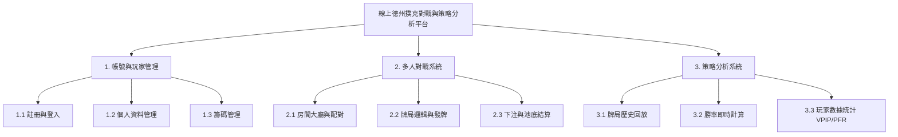
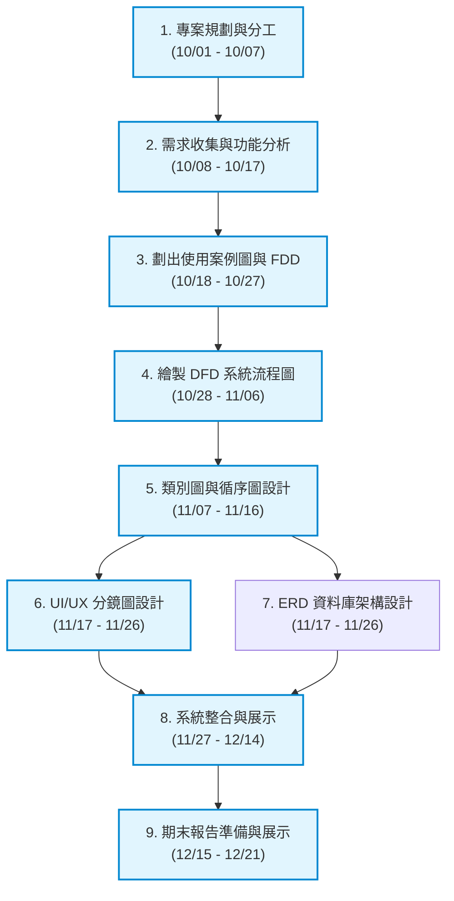

# 小組作業 3：需求分析與系統架構設計

* **專題名稱**：線上德州撲克多人對戰與策略分析平台
* **繳交日期**：2026/10/19

---

## 1. 系統需求分析

### (1) 功能性需求 (Functional Requirements)
1. **玩家對戰與房間管理**：系統須支援玩家建立房間、加入對戰、盲注設定與實時撲克發牌與下注流程。
2. **手牌歷史與數據記錄**：系統須自動記錄每場對局的過程（包括手牌、下注動作、池底大小），並提供玩家隨時查閱歷史牌局。
3. **策略分析與勝率計算**：系統須提供 EV (Expected Value) 勝率計算與 VPIP/PFR 等玩家風格數據分析，協助玩家檢討對局策略。

### (2) 非功能性需求 (Non-Functional Requirements)
1. **效能與實時性**：發牌與玩家下注動作的網路延遲 (Latency) 需低於 500 毫秒，以確保即時連線對戰順暢。
2. **安全性與公正性**：洗牌演算法須具備密碼學等級的隨機性 (RNG)，且玩家通訊須加密，防止看牌外掛與資料竄改。
3. **可用性與擴充性**：系統服務可用性 (Availability) 須達到 99.5% 以上，並能在熱門時段支援至少 1000 名玩家同時線上對戰。

---

## 2. 功能分解圖 (Functional Decomposition Diagram, FDD)

